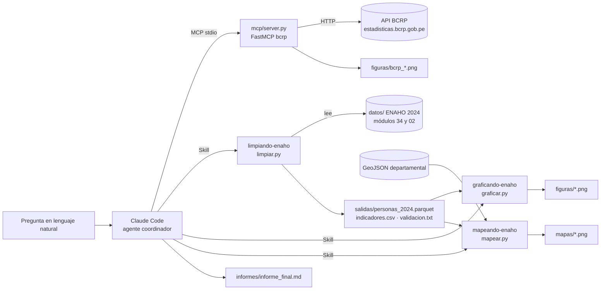
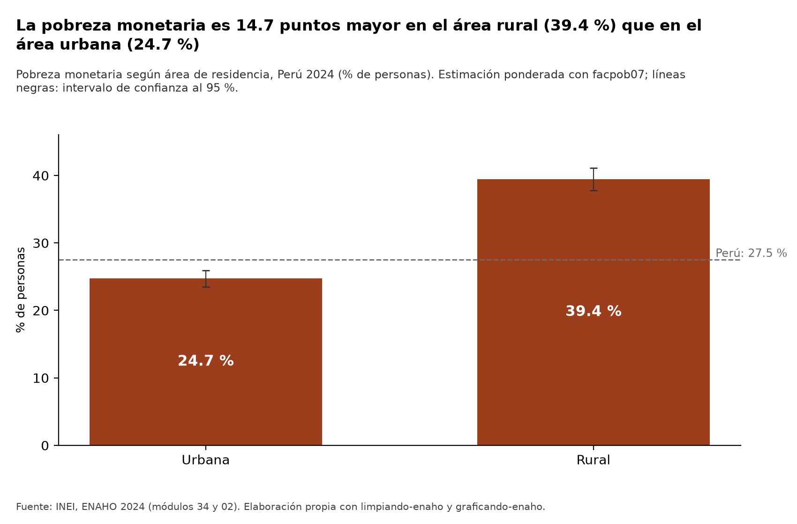
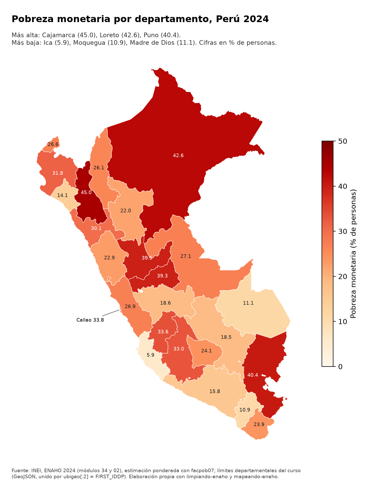
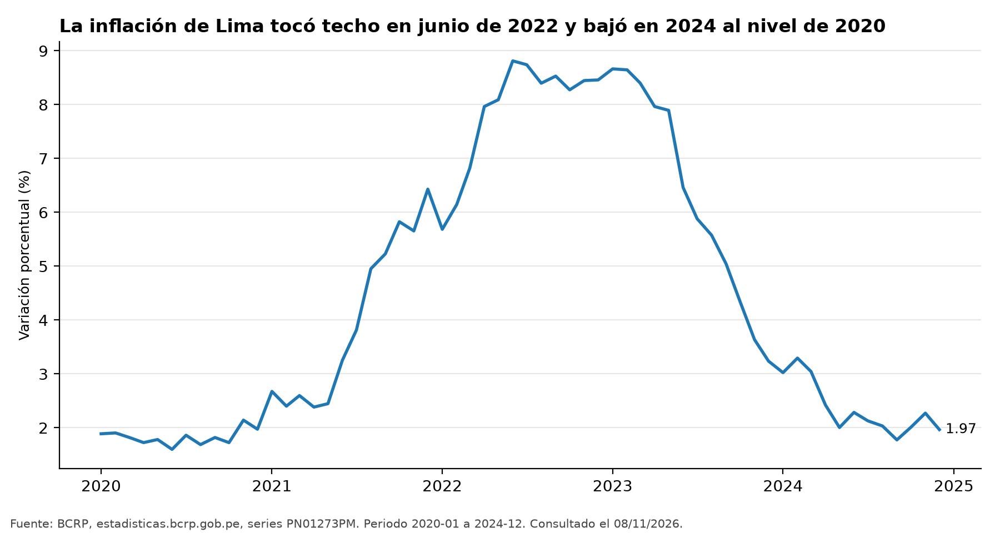

# Tarea 4 · Agente de investigación socioeconómica del Perú (MCP + Skills)

Curso **Python Intermedio** · Diplomado PUCP Data Science con Python · Trabajo individual.

## Objetivo

Construir un agente con **Claude Code** que investigue la realidad socioeconómica del Perú con datos oficiales y
herramientas propias, en lugar de responder de memoria:

- **BCRP**: un servidor **MCP** (FastMCP) consulta las series estadísticas oficiales y hace los cálculos en Python.
- **INEI, ENAHO 2024**: tres **Skills** de Claude Code limpian los microdatos, calculan la pobreza monetaria ponderada
  (con intervalos de confianza) y producen gráficos y un mapa departamental.

**Pregunta de investigación:** ¿Cómo evolucionaron la inflación y la actividad económica del Perú entre 2020 y 2024,
y qué brechas de pobreza monetaria entre departamentos y entre áreas urbana y rural había al cerrar ese período?
→ [`informes/informe_final.md`](informes/informe_final.md)

## Resultados en una mirada

| Componente | Resultado |
|---|---|
| Pruebas del servidor MCP | **10/10 aprobadas** (8 originales sin cambios + 2 de la herramienta propia) |
| Validación ENAHO 2024 | Pobreza nacional **27.53 %** (personas, `facpob07`) y **27.58 %** (método INEI) frente a 27.6 % ± 0.1 · **108,664** residentes habituales · **25/25** departamentos · 22/22 verificaciones |
| Ejecución integrada | Una sesión con **5 herramientas MCP + 1 recurso + 3 Skills**; informe con 6 hallazgos, 3 gráficos del BCRP, gráficos de la ENAHO y el mapa |
| Evaluación (10 preguntas) | Sin MCP/Skills **9/10** · con MCP/Skills **10/10** · 35.1 s frente a 21.0 s por pregunta · 4 frente a 0 respuestas sin ninguna fuente consultada |
| Verificación de cifras del informe | 6/6 coinciden con un recálculo independiente ([verificacion_cifras.md](informes/verificacion_cifras.md)) |
| Robustez (opcional) | 4/4 respuestas «NO DISPONIBLE» ante datos inexistentes |

## Arquitectura



- El **modelo decide** qué herramienta usar; **Python calcula**. Toda cifra sale de una llamada al MCP (con código de
  serie, periodo y URL) o de un script de las Skills (con su archivo en `salidas/`).
- Las Skills de gráficos y mapas revisan si existe la base procesada; si no, Claude ejecuta antes `limpiando-enaho`.

## Estructura

```text
tarea_4/
├── README.md · pyproject.toml · uv.lock · .mcp.json · .gitignore
├── mcp/                 server.py (servidor MCP) · test_server.py (8 pruebas originales + 2 propias)
├── .claude/skills/      limpiando-enaho/ · graficando-enaho/ · mapeando-enaho/ (SKILL.md + scripts/)
├── agente/              pregunta_investigacion.txt · ejecutar_agente.py (la ejecución integrada)
├── datos/               microdatos del INEI y GeoJSON (ignorados por git; se bajan solos)
├── salidas/             validacion.txt · indicadores.csv · validacion_mapa.txt · comparación con la referencia · pruebas_mcp.txt
├── figuras/ · mapas/    gráficos del BCRP y de la ENAHO · mapa coroplético
├── informes/            informe_final.md (escrito por el agente) · verificacion_cifras.md
├── evaluacion/          preguntas.csv · resultados.csv · comparacion.md · evaluar.py · verificar_esperadas.py
└── evidencias_ia/       mcp/ · skills/ · integracion/ · evaluacion/ · desarrollo/ (conversaciones exportadas)
```

## Parte 1 · Servidor MCP del BCRP (`mcp/server.py`)

Parte del proyecto de la [Sesión 04](https://github.com/d2cml-ai/Data-Science-Python/tree/main/sessions/04-mcp-claude-code/proyecto)
(completado antes en [serugiran96/mcp-bcrp](https://github.com/serugiran96/mcp-bcrp)) y lo amplía.

| Herramienta | Qué hace |
|---|---|
| `buscar_series` | Busca series en el catálogo oficial (17 mil series) por palabras y frecuencia |
| `serie` | Descarga los datos de una serie entre dos fechas (diaria, mensual, trimestral o anual), con la URL de la fuente |
| `resumen` | Primero, último, cambio, variación %, promedio, máximo y mínimo. Si la serie ya es una tasa, no calcula la variación % de una tasa y lo advierte |
| **`comparar_periodos`** (propia) | Compara una serie entre dos intervalos: estadísticas de cada uno, diferencia de promedios (en pp si es tasa) y cuál fue mayor. Probada con 2 pruebas nuevas |
| `graficar_serie` (propia) | Guarda en `figuras/` un gráfico de una o varias series con título, unidad, periodo y fuente |
| `correlacion` (propia) | Correlación de Pearson entre dos series en los periodos comunes |
| `comparar_paises` (propia) | Compara al Perú con otros países con la API del Banco Mundial |

- **Recursos:** `bcrp://serie/{codigo}` (ficha oficial de una serie) y `bcrp://series-clave` (códigos más usados).
- **Prompts:** `informe(tema)`, `interpretar_indicador(codigo, desde, hasta)` e `investigacion_socioeconomica(pregunta)`.
- **Pruebas:** `uv run pytest` → **10 passed** (las 8 originales sin cambios + 2 de `comparar_periodos`). Salida
  guardada en [`salidas/pruebas_mcp.txt`](salidas/pruebas_mcp.txt).
- Demostraciones desde Claude Code: [prompt MCP](evidencias_ia/mcp/demo_prompt_mcp_interpretar_indicador.md) ·
  [recursos MCP](evidencias_ia/mcp/demo_recurso_mcp_ficha_serie.md).

## Parte 2 · Skills de la ENAHO 2024 (`.claude/skills/`)

| Skill | Script | Entra | Sale |
|---|---|---|---|
| `limpiando-enaho` | `scripts/limpiar.py` (+ `estimacion.py`) | zip de los módulos 34 y 02 | `salidas/personas_2024.parquet`, `indicadores.csv`, `validacion.txt` |
| `graficando-enaho` | `scripts/graficar.py --tipo area\|sexo\|sexo_jefe\|edad\|region\|dominio\|departamento\|todos` | la base limpia | `figuras/pobreza_<tipo>.png` + `salidas/figura_<tipo>.csv` |
| `mapeando-enaho` | `scripts/mapear.py` | la base limpia + GeoJSON | `mapas/pobreza_departamento.png`, `comparacion_mapa_referencia.csv`, `validacion_mapa.txt` |

Reglas técnicas: llaves como texto (sin perder ceros), nombres normalizados, filtro de residentes habituales
`((p204 == 1) & (p205 == 2)) | ((p204 == 2) & (p206 == 1))`, unión `merge(..., validate="m:1")`, toda proporción
ponderada con `facpob07`, error estándar por diseño (conglomerado dentro de estrato) y unión del mapa por
`ubigeo[:2] = FIRST_IDDP` (nunca por nombre). Si falla una validación esencial, `limpiar.py` termina con código 1 y
no guarda la base. Detalle del método en [`reference.md`](.claude/skills/limpiando-enaho/reference.md).

Resultado de la validación ([`salidas/validacion.txt`](salidas/validacion.txt) y
[`salidas/validacion_mapa.txt`](salidas/validacion_mapa.txt)):

| Verificación | Valor | Referencia | Estado |
|---|---|---|---|
| Pobreza monetaria nacional (personas, `facpob07`) | 27.53 % (IC 95 %: 26.51-28.55) | 27.6 % ± 0.1 | ✅ |
| Pobreza monetaria nacional (sumaria, `factor07 × mieperho`) | 27.58 % | 27.6 % ± 0.1 | ✅ |
| Residentes habituales | 108,664 de 117,721 | 108,664 | ✅ |
| Unión `m:1` sin duplicar ni perder filas; llaves únicas | 108,664 → 108,664 | igual | ✅ |
| Códigos territoriales (`ubigeo[:2]`) con Lima y Callao separados | 25 (01-25) | 25 | ✅ |
| Urbana / rural | 24.74 % / 39.44 % (método INEI: 24.81 / 39.30) | 24.8 % / 39.3 % | ✅ |
| Sin ponderar (para mostrar por qué no vale) | 25.61 % | distinta | ✅ |
| Mapa: departamentos unidos por código con dato | 25/25 | 25 | ✅ |
| Mapa frente a la referencia de la Sesión 16 | máx. 0.0 pp (método INEI) · 0.5 pp (personas) · 25/25 dentro del IC 95 % | ≤ 0.1 pp | ✅ |

La diferencia de algunas décimas entre los dos métodos se debe a la población contada: residentes habituales del
módulo 02 frente a `mieperho` del INEI. Está explicada en
[`reference.md`](.claude/skills/limpiando-enaho/reference.md).

| Gráfico (ENAHO) | Mapa |
|---|---|
|  |  |

Activación y coordinación (sesiones reales de `claude -p`):
[un pedido de mapa encadena `limpiando-enaho` → `mapeando-enaho`](evidencias_ia/skills/demo1_mapa_encadena_skills.md) ·
[invocación directa `/graficando-enaho sexo`](evidencias_ia/skills/demo2_invocacion_directa_graficando.md) ·
[pregunta en lenguaje natural sobre Cusco](evidencias_ia/skills/demo3_pregunta_natural_cusco.md).

## Parte 3 · Ejecución integrada del agente

`uv run agente/ejecutar_agente.py` lanza **una sola sesión** de Claude Code con el MCP y las Skills, con la pregunta
y las instrucciones de [`agente/pregunta_investigacion.txt`](agente/pregunta_investigacion.txt). El agente planifica,
consulta el BCRP, corre las Skills, contrasta con las referencias y escribe el informe.

**Resultado** ([sesión completa](evidencias_ia/integracion/ejecucion_agente.md) ·
[resumen](evidencias_ia/integracion/resumen_ejecucion.json) · [informe](informes/informe_final.md)):

- Duración: 7 minutos, 69 turnos, una sola sesión de Claude Code.
- **Herramientas MCP distintas:** `buscar_series`, `serie`, `resumen`, `comparar_periodos` y `graficar_serie`, además
  del recurso `bcrp://series-clave`.
- **Skills distintas:** `limpiando-enaho`, `graficando-enaho` y `mapeando-enaho`.
- Condición de la consigna (≥ 2 herramientas MCP y ≥ 2 Skills en la misma ejecución): **cumple**.
- El informe tiene 6 hallazgos con su fuente (código de serie y periodo, o archivo), contraste con las referencias
  oficiales, interpretación, limitaciones, reproducibilidad y un registro de herramientas con las incidencias.
- Las incidencias que registró el agente se corrigieron después de la ejecución (ver la nota al final del informe).
- [Verificación independiente de 6 cifras](informes/verificacion_cifras.md) (3 del BCRP y 3 de la ENAHO): 6/6
  coinciden.



## Parte 4 · Evaluación: con y sin MCP/Skills

Las mismas 10 preguntas (4 del BCRP, 4 de la ENAHO y 2 mixtas), con respuestas esperadas fijadas y verificadas
antes de correr, se hicieron en sesiones independientes con el mismo modelo e instrucciones. **Modo A**: sin el MCP ni
las Skills, en una carpeta vacía fuera del repositorio. **Modo B**: con ambos. Las otras herramientas habilitadas
(búsqueda web, lectura de archivos y Bash limitado) fueron las mismas en los dos modos.

| | Modo A · sin MCP/Skills | Modo B · con MCP/Skills |
|---|---|---|
| Correctas | **9/10** | **10/10** |
| BCRP / ENAHO / mixtas | 3/4 · 4/4 · 2/2 | 4/4 · 4/4 · 2/2 |
| Incorrectas o sin respuesta | 1 (PBI 2024: dio 3.3 %, la cifra preliminar; la serie revisada dice 3.52 %) | 0 |
| Respuestas sin consultar ninguna fuente | 4 | 0 |
| Tiempo promedio | 35.1 s | 21.0 s |
| Costo estimado | US$ 1.20 | US$ 1.67 |

**Conclusión:** con MCP y Skills las respuestas fueron un poco más exactas, más rápidas y, sobre todo,
**verificables**: cada cifra cita la serie o el archivo del que sale. Análisis completo:
[`evaluacion/comparacion.md`](evaluacion/comparacion.md) · datos: [`evaluacion/resultados.csv`](evaluacion/resultados.csv)
· preguntas: [`evaluacion/preguntas.csv`](evaluacion/preguntas.csv).

## Fuentes de datos

| Fuente | Enlace | Uso |
|---|---|---|
| INEI · ENAHO 2024, módulo 34 (sumaria) | [966-Modulo34.zip](https://proyectos.inei.gob.pe/iinei/srienaho/descarga/STATA/966-Modulo34.zip) | pobreza e indicadores del hogar |
| INEI · ENAHO 2024, módulo 02 (miembros) | [966-Modulo02.zip](https://proyectos.inei.gob.pe/iinei/srienaho/descarga/STATA/966-Modulo02.zip) | características de las personas |
| Repositorio del curso · límites departamentales | [peru_departamental_simple.geojson](https://raw.githubusercontent.com/d2cml-ai/Data-Science-Python/main/sessions/06-geoespacial/lab/Data/peru_departamental_simple.geojson) | mapa (25 unidades) |
| BCRP · series estadísticas | [estadisticas.bcrp.gob.pe](https://estadisticas.bcrp.gob.pe/estadisticas/series/) (API sin clave) | inflación, PBI, tipo de cambio, tasa de referencia |
| Curso · referencia departamental | [pobreza_departamento_2024.csv](https://github.com/d2cml-ai/Data-Science-Python/blob/main/sessions/16-skills-enaho/referencias/pobreza_departamento_2024.csv) | validar el mapa |

Los microdatos no se suben al repositorio (`datos/` está en `.gitignore`); los scripts los bajan del INEI.

## Instalación y reproducción

Requisitos: [uv](https://docs.astral.sh/uv/), Python 3.11+ y [Claude Code](https://claude.com/claude-code) con sesión
iniciada (para las partes 3 y 4).

```bash
git clone https://github.com/serugiran96/diplomado_pucp_tareas_melinarozas.git
cd diplomado_pucp_tareas_melinarozas/tarea_4
uv sync                                                              # entorno: fastmcp, pandas, pyarrow, geopandas, matplotlib, pytest

# Parte 1 · servidor MCP
uv run pytest                                                        # 10 passed (pide datos reales al BCRP)

# Parte 2 · Skills (también se pueden correr a mano)
uv run .claude/skills/limpiando-enaho/scripts/limpiar.py --descargar  # baja los zip del INEI y valida
uv run .claude/skills/graficando-enaho/scripts/graficar.py --tipo todos
uv run .claude/skills/mapeando-enaho/scripts/mapear.py

# Parte 3 · agente (una sesión de Claude Code con MCP + Skills)
uv run agente/ejecutar_agente.py

# Parte 4 · evaluación
uv run evaluacion/verificar_esperadas.py                             # confirma las respuestas esperadas con cálculos independientes
uv run evaluacion/evaluar.py correr                                  # 20 sesiones: 10 preguntas × modos A y B
uv run evaluacion/evaluar.py calificar                               # resultados.csv
```

### Conectar el MCP a Claude Code

El archivo [`.mcp.json`](.mcp.json) ya declara el servidor. Al abrir Claude Code dentro de `tarea_4/`, aprueben el
servidor `bcrp` (o ejecuten `claude mcp add --scope project bcrp -- uv run mcp/server.py`). Comprueben con `/mcp`
que aparece conectado y con `/skills` que están las tres Skills. Sin interfaz:

```bash
claude -p "¿Cuál fue la inflación de Lima en diciembre de 2024?" --mcp-config .mcp.json --allowedTools "mcp__bcrp__*"
```

### Ejemplo de una ejecución completa

```text
> Haz un mapa de la pobreza monetaria por departamento con ENAHO 2024.
  Skill(mapeando-enaho)  → no existe salidas/personas_2024.parquet
  Skill(limpiando-enaho) → uv run .../limpiar.py → 22/22 verificaciones; pobreza 27.53 % (27.58 % método INEI)
  uv run .../mapear.py   → 25/25 departamentos unidos por código; Cajamarca 45.0 %, Ica 5.9 %
  → mapas/pobreza_departamento.png
```

Transcripción completa: [`evidencias_ia/skills/demo1_mapa_encadena_skills.md`](evidencias_ia/skills/demo1_mapa_encadena_skills.md).

## Limitaciones y problemas encontrados

- **Dos métodos de ponderación en la ENAHO.** La base de personas (`facpob07`, la que pide el curso) y el método
  oficial (`factor07 × mieperho`) difieren en algunas décimas en subgrupos pequeños (hasta 0.5 pp en Huánuco). Se
  reportan los dos y se explica la diferencia; nunca se ajustó un resultado para acercarlo a la referencia.
- **Intervalos de confianza aproximados.** Se usa `estrato` como estrato de diseño; el diseño oficial del INEI tiene
  estratos más finos, así que los IC pueden ser algo más anchos que los publicados.
- **Las pruebas del MCP usan la API real del BCRP.** Necesitan internet y, si el BCRP revisa una serie, un valor esperado
  podría cambiar. El servidor reintenta cuando la API limita los pedidos (responde HTML en vez de JSON).
- **Alcance del análisis.** La inflación es del IPC de Lima Metropolitana y la pobreza es nacional y departamental, de
  un solo año (2024). El informe describe asociaciones, no causas.
- **Evaluación pequeña.** Son 10 preguntas con una sola ejecución cada una. El modo A tenía búsqueda web y el modelo
  conoce muchas cifras publicadas, lo que reduce la diferencia de aciertos. La interpretación de las 2 preguntas mixtas
  se calificó con una rúbrica escrita ([`revision_interpretacion.csv`](evaluacion/revision_interpretacion.csv)).
- **Problemas encontrados y cómo se resolvieron:**
  - `resumen` daba variaciones % de una tasa (sin sentido económico): ahora devuelve `None` con una nota.
  - `buscar_series` no encontraba «pbi var% 12 meses»: se agregaron sinónimos y un mejor orden de resultados.
  - El eje de `graficar_serie` se cortaba y mostraba meses en series anuales: se corrigió.
  - La rural-urbana difería 0.14 pp de la referencia: se identificó la causa (`mieperho`) y se documentó.
  - El agente no podía usar `curl` por permisos: hizo el contraste con otra serie del BCRP, y la verificación
    independiente se agregó aparte.
  - En el modo B, el agente a veces leyó las salidas ya validadas de las Skills en vez de volver a correrlas; es
    legítimo, pero hace que las Skills se activen menos de lo que podrían.

## Evidencias del uso de inteligencia artificial

Todo el proyecto se desarrolló con **Claude Code (Opus 5.5)**. En [`evidencias_ia/`](evidencias_ia/) están las
conversaciones exportadas en Markdown (opción B), con el correo, las rutas personales y la información ajena a la
tarea ocultos:

| Carpeta | Qué contiene |
|---|---|
| [`evidencias_ia/desarrollo/`](evidencias_ia/desarrollo/) | La conversación completa con Claude Code en la que se construyó esta tarea (MCP, Skills, integración, evaluación, correcciones y documentación) y la de la Sesión 04, donde se desarrolló el servidor MCP original |
| [`evidencias_ia/mcp/`](evidencias_ia/mcp/) | Sesiones que usan el prompt y los recursos MCP desde Claude Code |
| [`evidencias_ia/skills/`](evidencias_ia/skills/) | Tres sesiones de activación de las Skills: encadenada, directa y por lenguaje natural |
| [`evidencias_ia/integracion/`](evidencias_ia/integracion/) | La ejecución integrada del agente que escribió el informe |
| [`evidencias_ia/evaluacion/`](evidencias_ia/evaluacion/) | Las 20 sesiones del experimento (modo A y modo B) y las 4 de robustez |

Cada sesión de `claude -p` está en dos formatos: `.md`, legible, y `.jsonl`, el registro original saneado. Índice
detallado: [`evidencias_ia/README.md`](evidencias_ia/README.md).
