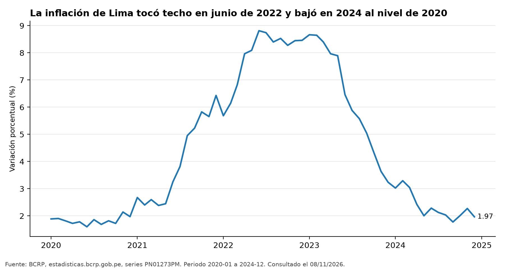
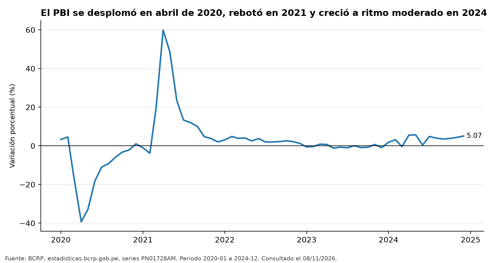
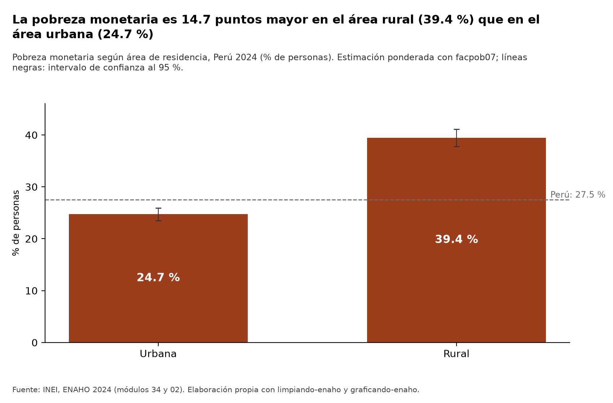
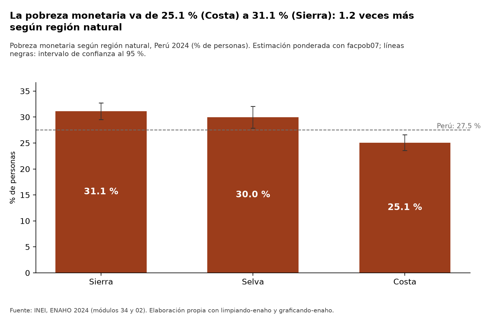
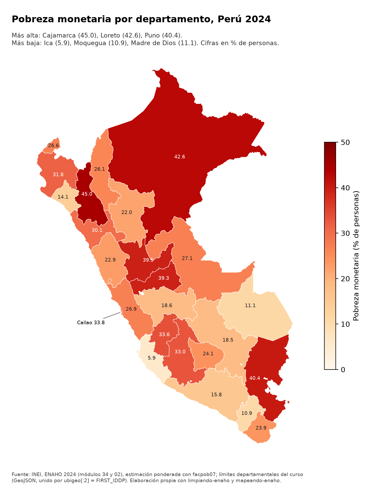
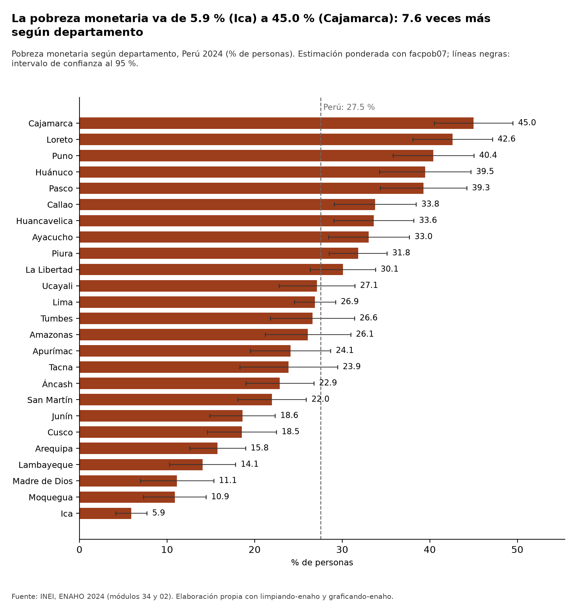

# Inflación, actividad económica y brechas de pobreza monetaria en el Perú, 2020-2024

*Informe generado por el agente de investigación socioeconómica (Claude Code + servidor MCP `bcrp` + skills de la ENAHO), ejecución del 8 de noviembre de 2026. Todas las cifras salen de herramientas o de archivos generados en esta ejecución; no se escribió ninguna de memoria.*

---

## 1. Pregunta de investigación

**Pregunta.** ¿Cómo evolucionaron la inflación y la actividad económica del Perú entre 2020 y 2024, y qué brechas de pobreza monetaria entre departamentos y entre áreas urbana y rural había al cerrar ese período, según la ENAHO 2024?

- **Tema.** Contexto macroeconómico (precios y producción) del quinquenio 2020-2024 y distribución territorial de la pobreza monetaria al final del período.
- **Objetivo.** (a) Describir la trayectoria de la inflación de Lima Metropolitana y del crecimiento del PBI real entre 2020 y 2024, comparando el subperíodo 2020-2022 (choque de la pandemia, rebote y alza de precios) con 2023-2024; (b) estimar, con la ENAHO 2024, la pobreza monetaria por área de residencia, región natural y departamento, con intervalos de confianza; (c) contrastar ambas cifras con referencias oficiales.
- **Delimitación.**
  - *Temporal:* series del BCRP de enero de 2020 a diciembre de 2024 (mensuales) y de 2020 a 2024 (anuales); pobreza solo para 2024 (un corte transversal, no una serie).
  - *Territorial:* inflación de **Lima Metropolitana** (IPC de Lima); PBI **nacional**; pobreza **nacional**, por área (urbana/rural), región natural (costa/sierra/selva) y 25 departamentos (Lima y Callao separados).
  - *Conceptual:* pobreza **monetaria** (gasto per cápita del hogar por debajo de la línea de pobreza, variable `pobreza` de la sumaria), medida en % de personas.

## 2. Fuentes y metodología

**Plan de trabajo.** La parte macro de la pregunta la responde el BCRP mediante el servidor MCP `bcrp`, y la parte de pobreza al cierre la responde la ENAHO 2024 mediante las tres skills del proyecto.

| Parte de la pregunta | Fuente | Herramienta |
|---|---|---|
| Inflación 2020-2024 | BCRP, IPC de Lima Metropolitana | MCP `bcrp`: `buscar_series`, recurso `bcrp://series-clave`, `serie`, `resumen`, `comparar_periodos`, `graficar_serie` |
| Actividad económica 2020-2024 | BCRP, PBI real | ídem |
| Pobreza 2024 por área, región y departamento | INEI, ENAHO 2024, módulos 34 (sumaria) y 02 (miembros del hogar) | skills `limpiando-enaho`, `graficando-enaho`, `mapeando-enaho` |

**BCRP.** Los códigos se confirmaron con el recurso `bcrp://series-clave` y con `buscar_series` antes de usarlos:

| Código | Serie (nombre devuelto por la herramienta) | Frecuencia |
|---|---|---|
| `PN01273PM` | Índice de precios Lima Metropolitana (var% 12 meses) - IPC | Mensual |
| `PN09822PM` | Índice de precios Lima Metropolitana (var% 12 meses) - IPC Alimentos y Bebidas | Mensual |
| `PM05197PA` | Índices fin de periodo (variación porcentual) - IPC (dic/dic) | Anual |
| `PN01728AM` | Producto bruto interno y demanda interna (variación porcentual interanual) - PBI | Mensual |
| `PM04923AA` | Producto bruto interno por tipo de gasto (variaciones porcentuales reales) - PBI | Anual |
| `PM04863AA` | Producto bruto interno y otros indicadores - PBI (variación porcentual) | Anual (solo para contraste) |

Todos los cálculos (promedios, extremos, cambios y diferencias entre períodos) los hicieron `resumen` y `comparar_periodos`; no se hizo ninguna cuenta a mano. Como las series ya son tasas de variación, los cambios se leen en **puntos porcentuales (pp)** y **no se usa** el campo `variacion_pct` (variación % de una tasa), que no tiene sentido económico (ver Registro de herramientas).

**ENAHO 2024.** `limpiando-enaho` (`scripts/limpiar.py`) lee la sumaria y el módulo 02, filtra a los residentes habituales, une persona-hogar por `conglome`, `vivienda` y `hogar` (`validate='m:1'`), define `pobre = pobreza <= 2` y pondera con el factor de expansión de personas `facpob07`. Los errores estándar se calculan por diseño muestral (linealización de Taylor, conglomerados dentro de estratos) y los IC son al 95 %. `graficando-enaho` y `mapeando-enaho` reutilizan esas estimaciones. El mapa une indicadores y geometrías **por código** (`ubigeo[:2] = FIRST_IDDP`), no por nombre.

**Criterio de comparación.** Siguiendo la skill, una diferencia entre grupos cuyos IC 95 % se superponen **no** se trata como una diferencia clara.

## 3. Resultados

### Hallazgo 1. La inflación de Lima describió una «joroba»: subió hasta 8.81 % en junio de 2022 y en diciembre de 2024 volvió a 1.97 %, un nivel casi igual al de enero de 2020

- Al inicio del período la inflación a 12 meses era **1.89 %** (2020-01) y su mínimo fue **1.60 %** (2020-06). Alcanzó el máximo de **8.81 %** en **2022-06** y cerró en **1.97 %** (2024-12). El cambio entre el primer y el último mes es de **+0.08 pp** y el promedio 2020-2024 es de **4.47 %**. *Fuente: `PN01273PM`, 2020-01 a 2024-12, `resumen`; <https://estadisticas.bcrp.gob.pe/estadisticas/series/api/PN01273PM/json/2020-1/2024-12>.*
- **2020-2022 frente a 2023-2024.** En el período A (2020-01 a 2022-12) la inflación subió **+6.57 pp** (de 1.89 % a 8.46 %), con promedio de **4.55 %**. En el período B (2023-01 a 2024-12) bajó **−6.70 pp** (de 8.66 % a 1.97 %), con promedio de **4.33 %** y mínimo de **1.78 %** en 2024-09. La diferencia de promedios (B − A) es de apenas **−0.22 pp**. *Fuente: `PN01273PM`, `comparar_periodos` (A: 2020-01 a 2022-12; B: 2023-01 a 2024-12); URL: …/PN01273PM/json/2020-1/2022-12 y …/PN01273PM/json/2023-1/2024-12.*
- Inflación anual dic/dic: **1.97 %** (2020), **6.43 %** (2021), **8.46 %** (2022), **3.24 %** (2023) y **1.97 %** (2024). *Fuente: `PM05197PA`, 2020-2024, `serie`; <https://estadisticas.bcrp.gob.pe/estadisticas/series/api/PM05197PA/json/2020/2024>.*

> Los promedios de ambos subperíodos son casi iguales y ocultan trayectorias opuestas: alza en 2020-2022 y desinflación en 2023-2024. El cambio dentro de cada período (+6.57 pp frente a −6.70 pp) describe mejor la dinámica que la diferencia de promedios.

### Hallazgo 2. La inflación de alimentos y bebidas tocó techo después que la general (13.16 % en febrero de 2023) y su promedio de 2023-2024 fue mayor que el de 2020-2022

- La inflación a 12 meses de alimentos y bebidas en Lima pasó de **1.11 %** (2020-01) a un máximo de **13.16 %** (**2023-02**) y cerró en **1.25 %** (2024-12), con mínimo de **0.69 %** (2024-09). *Fuente: `PN09822PM`, 2020-01 a 2024-12, `resumen`; <https://estadisticas.bcrp.gob.pe/estadisticas/series/api/PN09822PM/json/2020-1/2024-12>.*
- A diferencia del IPC general, el promedio del período B (**6.04 %**) supera al del período A (**5.78 %**), con una diferencia de **+0.26 pp** (`mayor_promedio = B`). En 2022-12 la tasa todavía era de **12.64 %**. *Fuente: `PN09822PM`, `comparar_periodos` (A: 2020-01 a 2022-12; B: 2023-01 a 2024-12).*

### Hallazgo 3. La actividad se desplomó en 2020, rebotó en 2021, se contrajo levemente en 2023 y se recuperó en 2024

- Crecimiento anual del PBI real: **−10.93 %** (2020), **13.42 %** (2021), **2.82 %** (2022), **−0.35 %** (2023) y **3.52 %** (2024). El promedio 2020-2024 es de **1.69 %**. *Fuente: `PM04923AA`, 2020-2024, `serie` y `resumen`; <https://estadisticas.bcrp.gob.pe/estadisticas/series/api/PM04923AA/json/2020/2024>.*
- En la serie mensual, el mínimo fue **−39.28 %** interanual (**2020-04**) y el máximo **59.89 %** (**2021-04**, efecto rebote sobre una base deprimida). El año cerró en **5.07 %** (2024-12). *Fuente: `PN01728AM`, 2020-01 a 2024-12, `resumen`; <https://estadisticas.bcrp.gob.pe/estadisticas/series/api/PN01728AM/json/2020-1/2024-12>.*
- **2020-2022 frente a 2023-2024.** Con datos mensuales, el promedio cae de **2.70 %** (A) a **1.57 %** (B), una diferencia de **−1.12 pp**. En B, el mínimo fue **−1.17 %** (2023-05) y el máximo **5.71 %** (2024-05). Con datos anuales, el promedio pasa de **1.77 %** a **1.58 %** (**−0.18 pp**). *Fuente: `PN01728AM` y `PM04923AA`, `comparar_periodos`.*

### Hallazgo 4. Al cierre de 2024, la pobreza monetaria rural (39.4 %) superaba a la urbana (24.7 %) en 14.7 puntos, una brecha clara

- Pobreza monetaria nacional: **27.5 %** (IC 95 %: 26.5-28.5). *Fuente: INEI, ENAHO 2024; `salidas/validacion.txt` y `salidas/indicadores.csv`.*
- **Rural: 39.4 %** (IC 95 %: 37.8-41.1; n = 36,071 personas). **Urbana: 24.7 %** (IC 95 %: 23.5-25.9; n = 72,593). La brecha es de **14.7 puntos** y los intervalos no se superponen. *Fuente: INEI, ENAHO 2024; `salidas/figura_area.csv` y salida de `graficar.py --tipo area`.*
- Pobreza extrema nacional: **5.5 %** (IC 95 %: 5.0-6.0). *Fuente: `salidas/indicadores.csv`.*

### Hallazgo 5. La sierra (31.1 %) y la selva (30.0 %) tenían más pobreza que la costa (25.1 %); entre sierra y selva no hay una diferencia clara

- **Sierra: 31.1 %** (IC 95 %: 29.5-32.7); **Selva: 30.0 %** (IC 95 %: 27.9-32.1); **Costa: 25.1 %** (IC 95 %: 23.5-26.6). *Fuente: INEI, ENAHO 2024; `salidas/figura_region.csv`.*
- Los IC de sierra y selva se superponen, así que **no** puede afirmarse que una sea más pobre que la otra. El IC de la costa no toca el de ninguna de las dos.
- Lima Metropolitana (dominio 8), el ámbito del IPC usado en los hallazgos 1 y 2, tenía **28.0 %** de pobreza (IC 95 %: 25.7-30.4). *Fuente: `salidas/indicadores.csv`; `salidas/validacion.txt`.*

### Hallazgo 6. Las brechas departamentales son amplias: de 5.9 % en Ica a 45.0 % en Cajamarca (7.6 veces)

- **Más pobres:** Cajamarca **45.0 %** (IC 95 %: 40.5-49.5), Loreto **42.6 %** (38.1-47.1) y Puno **40.4 %** (35.8-45.0); les siguen Huánuco **39.5 %** (34.3-44.7) y Pasco **39.3 %** (34.3-44.2). *Fuente: `salidas/figura_departamento.csv`; salida de `mapear.py`.*
- **Menos pobres:** Ica **5.9 %** (4.1-7.7), Moquegua **10.9 %** (7.3-14.4) y Madre de Dios **11.1 %** (6.9-15.3).
- Rango: «va de 5.9 % (Ica) a 45.0 % (Cajamarca): 7.6 veces más según departamento». *Fuente: título calculado por `graficar.py --tipo departamento`.*
- **Cautela:** el IC de Cajamarca se superpone con los de Loreto, Puno, Huánuco y Pasco, así que el ordenamiento dentro de ese grupo no es estadísticamente claro. Lo robusto es que existe un **grupo** de departamentos, sobre todo de sierra y selva, con pobreza cercana o superior al 40 %, frente a otro grupo con menos de 16 %, mayormente costero (Ica, Moquegua, Lambayeque, Arequipa), al que se suma Madre de Dios. Lima (**26.9 %**, IC 24.5-29.2) y Callao (**33.8 %**, IC 29.1-38.4) se estimaron por separado.

### Contraste con referencias oficiales

| Cifra | Este informe | Referencia | Resultado | Fuente del contraste |
|---|---|---|---|---|
| Pobreza nacional (método INEI, sumaria) | 27.58 % | 27.6 % ± 0.1 | APROBADA | `salidas/validacion.txt` |
| Pobreza nacional (personas, `facpob07`) | 27.53 % | 27.6 % ± 0.1 | APROBADA | `salidas/validacion.txt` |
| Pobreza urbana (personas \| sumaria) | 24.74 % \| 24.81 % | ≈ 24.8 % | APROBADA | `salidas/validacion.txt` |
| Pobreza rural (personas \| sumaria) | 39.44 % \| 39.30 % | ≈ 39.3 % | APROBADA | `salidas/validacion.txt` |
| Pobreza extrema | 5.50 % \| 5.50 % | ≈ 5.5 % | APROBADA | `salidas/validacion.txt` |
| Validación global ENAHO | 22/22 verificaciones; 0 esenciales fallidas | — | APROBADA | `salidas/validacion.txt` |
| Departamentos unidos al mapa | 25 | 25 | APROBADA | `salidas/validacion_mapa.txt` |
| Máx. diferencia por departamento, método INEI | 0.0 pp | ≤ 0.1 pp | APROBADA | `salidas/validacion_mapa.txt` |
| Máx. diferencia por departamento, base de personas | 0.5 pp (Huánuco) | ≤ 0.6 pp | APROBADA | `salidas/validacion_mapa.txt` |
| Referencia dentro del IC 95 % | 25/25 | 25/25 | APROBADA | `salidas/comparacion_mapa_referencia.csv` |
| Departamento con mayor / menor pobreza | Cajamarca / Ica | Cajamarca / Ica | APROBADA | `salidas/validacion_mapa.txt` |
| Inflación dic-2022 y dic-2024: `PM05197PA` frente a `PN01273PM` | 8.4592 y 1.9663 en ambas series | — | Coinciden | herramientas `serie` y `comparar_periodos` |
| PBI anual: `PM04923AA` frente a `PM04863AA` | −10.9333, 13.4166, 2.8182, −0.3507, 3.5153 en ambas | — | Coinciden | herramienta `serie` |

Las URL del BCRP citadas arriba son las que devolvió cada herramienta. No se hizo una descarga directa e independiente de esas URL (con `curl`) porque el comando requería una aprobación que no se pidió en esta ejecución. En su lugar, el contraste se hizo entre series distintas del propio BCRP, que coinciden exactamente.

## 4. Visualizaciones

**Figura 1. Inflación de Lima Metropolitana a 12 meses, 2020-01 a 2024-12** (`PN01273PM`, generada con `graficar_serie`).



**Figura 2. Crecimiento interanual del PBI real, 2020-01 a 2024-12** (`PN01728AM`, generada con `graficar_serie`).



*También se generó la versión anual (`PM04923AA`) en [`../figuras/bcrp_pbi_var_anual_2020_2024.png`](../figuras/bcrp_pbi_var_anual_2020_2024.png). No se inserta porque `graficar_serie` rotula el eje horizontal con meses («2020-07», «2021-07»…) aunque los datos son anuales, lo que puede confundir; los valores son correctos.*

**Figura 3. Pobreza monetaria según área de residencia, 2024** (`graficando-enaho --tipo area`).



**Figura 4. Pobreza monetaria según región natural, 2024** (`graficando-enaho --tipo region`).



**Figura 5. Mapa de la pobreza monetaria por departamento, 2024** (`mapeando-enaho`).



**Figura 6. Pobreza monetaria por departamento con IC 95 %, 2024** (`graficando-enaho --tipo departamento`). Complementa el mapa, que no muestra la incertidumbre.



## 5. Interpretación

1. **Un quinquenio de choques sucesivos.** Las series del BCRP muestran tres fases: (i) en 2020, el colapso de la actividad (−10.93 % anual; −39.28 % interanual en abril) con inflación baja; (ii) en 2021-2022, el rebote del PBI (13.42 % en 2021) y luego la desaceleración (2.82 % en 2022), mientras la inflación escalaba hasta 8.81 % (junio de 2022); (iii) en 2023-2024, la desinflación (hasta 1.97 % en diciembre de 2024) junto con una contracción leve en 2023 (−0.35 %) y la recuperación en 2024 (3.52 %). Al cerrar 2024 el entorno era de inflación baja (1.97 %) y crecimiento positivo (5.07 % interanual en diciembre).
2. **Por qué importa la inflación de alimentos.** Los precios de alimentos y bebidas siguieron subiendo cuando la inflación general ya había alcanzado su máximo: su pico llegó en febrero de 2023 (13.16 %) y su promedio de 2023-2024 superó al de 2020-2022. Como los alimentos pesan más en el gasto de los hogares de menores ingresos, es plausible que esa presión haya afectado más a esos hogares. Esta ejecución **no** pone a prueba esa hipótesis (no dispone de la estructura de gasto por quintil ni de una serie de pobreza 2020-2023).
3. **Dónde estaba la pobreza al cierre.** En 2024 algo más de una de cada cuatro personas era pobre en términos monetarios (27.5 %). La pobreza se concentraba en el área rural (39.4 % frente a 24.7 % urbana) y en la sierra y la selva frente a la costa. Las brechas departamentales son mucho mayores que las de área o región: la tasa de Cajamarca es 7.6 veces la de Ica. Las dos dimensiones se combinan: los departamentos más pobres (Cajamarca, Loreto, Puno, Huánuco, Pasco) están en la sierra o la selva.
4. **Lima no es el país, pero tampoco es un caso aparte.** La inflación del informe se mide en Lima Metropolitana, cuya pobreza (28.0 %) es estadísticamente similar a la nacional (27.5 %, dentro del IC de Lima Metropolitana). El IPC de Lima describe los precios que enfrenta la población de Lima Metropolitana (11,388,153 personas según la expansión de la ENAHO, `salidas/indicadores.csv`), pero no necesariamente los de los hogares rurales de la sierra y la selva, donde la pobreza es mayor.
5. **Lectura conjunta.** El BCRP describe el **contexto** temporal y la ENAHO 2024 describe el **resultado** distributivo al final. Juntos permiten decir que el período cerró con una macroeconomía estabilizada y una pobreza territorialmente muy desigual; no permiten afirmar cuánto de esa pobreza se debe a la inflación o a la recesión de 2023.

## 6. Limitaciones

- **Cobertura temporal desigual.** Las series del BCRP cubren 2020-2024 completo; la pobreza se observa solo en 2024 (un corte transversal). Sin la ENAHO de 2020 a 2023 en esta ejecución no puede decirse si la pobreza subió o bajó durante el período, ni relacionar año por año la inflación con la pobreza.
- **IPC de Lima frente a pobreza nacional.** La inflación (`PN01273PM`, `PN09822PM`, `PM05197PA`) corresponde solo a Lima Metropolitana; la pobreza es nacional y departamental. Los precios en zonas rurales y en otros departamentos pueden haber evolucionado de otra manera.
- **Distinto nivel de agregación.** El PBI es un agregado nacional sin desagregar por departamento en este informe, la inflación es de una sola ciudad y la pobreza es un indicador de personas desagregado hasta el nivel departamental. Las unidades de análisis no coinciden, de modo que no hay correspondencia uno a uno entre las cifras macro y las territoriales.
- **Error muestral de la encuesta.** Las cifras de la ENAHO son estimaciones con IC 95 %. Los intervalos departamentales son amplios (por ejemplo, Madre de Dios: 6.9-15.3; Tacna: 18.3-29.5) y varios se superponen, así que el ordenamiento fino entre departamentos (por ejemplo, Cajamarca frente a Loreto o Puno) no es concluyente. El mapa (Figura 5) no muestra esa incertidumbre; para eso está la Figura 6.
- **Asociación no es causalidad.** Que la pobreza sea mayor en las zonas rurales y en la sierra y la selva, o que la inflación de alimentos haya sido alta, no implica que una variable cause la otra. El informe describe coincidencias, no efectos.
- **Diferencias de método en la ENAHO.** La estimación por personas (`facpob07`) y el método INEI (sumaria, `factor07 × mieperho`) difieren en algunas décimas: hasta 0.5 pp por departamento (Huánuco) y 0.18 pp en Lima Metropolitana. Siempre quedan dentro del IC 95 % (`salidas/validacion_mapa.txt`, `salidas/validacion.txt`).
- **Medida de pobreza.** Solo se analiza la pobreza monetaria; no se usaron indicadores no monetarios (NBI, acceso a servicios).
- **Limitaciones de las herramientas** (ver el Registro de herramientas): `variacion_pct` sin sentido en series de tasas, eje mensual en el gráfico anual y búsquedas sin resultados.

## 7. Reproducibilidad

**Entorno.** Proyecto `tarea_4/` con `uv` (`pyproject.toml`, `uv.lock`); Python ≥ 3.11; dependencias `fastmcp`, `httpx`, `pandas`, `pyarrow`, `geopandas` y `matplotlib`. El servidor MCP se declara en `.mcp.json` y se lanza con `uv run --quiet mcp/server.py`.

**Ejecución completa del agente (esta misma sesión):**

```bash
uv run agente/ejecutar_agente.py   # lee agente/pregunta_investigacion.txt y guarda evidencias_ia/integracion/
```

**Pasos de la ENAHO (desde la raíz `tarea_4/`):**

```bash
uv run .claude/skills/limpiando-enaho/scripts/limpiar.py                      # usa datos/966-Modulo34.zip y datos/966-Modulo02.zip
uv run .claude/skills/graficando-enaho/scripts/graficar.py --tipo area
uv run .claude/skills/graficando-enaho/scripts/graficar.py --tipo region
uv run .claude/skills/graficando-enaho/scripts/graficar.py --tipo departamento
uv run .claude/skills/mapeando-enaho/scripts/mapear.py                        # usa datos/peru_departamental_simple.geojson
```

Si faltan los zip del INEI, `limpiar.py --descargar` los baja (966 = ENAHO 2024).

**Llamadas MCP del BCRP (servidor `bcrp`):**

| Herramienta | Argumentos |
|---|---|
| `resumen` | `PN01273PM`, 2020-01 a 2024-12 · `PN09822PM`, 2020-01 a 2024-12 · `PN01728AM`, 2020-01 a 2024-12 · `PM04923AA`, 2020 a 2024 |
| `comparar_periodos` | mismos cuatro códigos; A = 2020-01 a 2022-12 (o 2020 a 2022), B = 2023-01 a 2024-12 (o 2023 a 2024) |
| `serie` | `PM05197PA`, `PM04923AA` y `PM04863AA`, 2020 a 2024 |
| `graficar_serie` | `["PN01273PM"]`, 2020-01 a 2024-12 → `bcrp_inflacion_lima_12m_2020_2024.png` · `["PN01728AM"]`, 2020-01 a 2024-12 → `bcrp_pbi_var_interanual_2020_2024.png` · `["PM04923AA"]`, 2020 a 2024 → `bcrp_pbi_var_anual_2020_2024.png` |

**Archivos de entrada:** `datos/966-Modulo34.zip` (sumaria-2024.dta), `datos/966-Modulo02.zip` (enaho01-2024-200.dta), `datos/peru_departamental_simple.geojson`, `.claude/skills/mapeando-enaho/referencias/pobreza_departamento_2024.csv`; API del BCRP (`https://estadisticas.bcrp.gob.pe/estadisticas/series/api/...`), consultada el 2026-11-08.

**Archivos generados o regenerados en esta ejecución:**

- `salidas/validacion.txt`, `salidas/indicadores.csv`, `salidas/personas_2024.parquet` (no versionado)
- `salidas/figura_area.csv`, `salidas/figura_region.csv`, `salidas/figura_departamento.csv`
- `salidas/validacion_mapa.txt`, `salidas/comparacion_mapa_referencia.csv`
- `figuras/bcrp_inflacion_lima_12m_2020_2024.png`, `figuras/bcrp_pbi_var_interanual_2020_2024.png`, `figuras/bcrp_pbi_var_anual_2020_2024.png`
- `figuras/pobreza_area.png`, `figuras/pobreza_region.png`, `figuras/pobreza_departamento.png`, `mapas/pobreza_departamento.png`
- `informes/informe_final.md` (este archivo)

## 8. Registro de herramientas

**Herramientas MCP (servidor `bcrp`) usadas en esta ejecución:**

| Herramienta | Llamadas | Para qué | Incidencias |
|---|---|---|---|
| `ReadMcpResourceTool` → `bcrp://series-clave` | 1 | Lista de códigos clave (inflación, PBI) | Ninguna |
| `buscar_series` | 9 | Confirmar `PN01273PM`, `PN01728AM` y `PM04923AA` (y hallar `PM04863AA`) | «pbi var% 12 meses» y «pbi var%» (anual) devolvieron **0 resultados**; «pbi» (mensual) devolvió series sectoriales. Se resolvió con otras palabras: «variación porcentual interanual pbi» y «variaciones porcentuales reales pbi» |
| `serie` | 3 | `PM04923AA`, `PM04863AA` (contraste) y `PM05197PA` | Ninguna |
| `resumen` | 4 | Extremos, promedios y cambios 2020-2024 | En series que ya son tasas devolvió `variacion_pct` (por ejemplo, 4.13 % o −132.15 %), un valor **sin interpretación económica**; no se usa en el informe |
| `comparar_periodos` | 4 | 2020-2022 frente a 2023-2024 | Igual que arriba: `variacion_pct` y `variacion_pct_promedios` (por ejemplo, −976.05 % o −1102.37 %) se ignoraron; solo se usan promedios, extremos, cambios en pp y `diferencia_promedios` |
| `graficar_serie` | 5 (3 archivos) | Figuras 1 y 2 y versión anual del PBI | (1) Títulos largos se cortaban: se regeneraron dos gráficos con títulos más cortos. (2) En la serie anual el eje x muestra meses. (3) La etiqueta del eje y se trunca cuando la unidad es larga |

**Skills del proyecto usadas en esta ejecución:**

| Skill | Comando | Resultado |
|---|---|---|
| `limpiando-enaho` | `limpiar.py` | **APROBADA**: 22/22 verificaciones, 0 esenciales fallidas; 108,664 residentes; población expandida de 34,147,768 |
| `graficando-enaho` | `graficar.py --tipo area`, `--tipo region`, `--tipo departamento` | 3 figuras y 3 tablas CSV con IC 95 % |
| `mapeando-enaho` | `mapear.py` | **APROBADA**: 7/7 verificaciones del mapa; 25 departamentos unidos por código; Lima y Callao separados |

**Otras observaciones de la ejecución:**

- El `SKILL.md` de `graficando-enaho` decía «Si el pedido es `área urbana y rural, y región natural`, úsalo como tipo», lo que parece una sustitución literal del argumento en la plantilla. Ese texto no es un `--tipo` válido, así que se tradujo, según la tabla de la propia skill, a dos ejecuciones válidas: `--tipo area` y `--tipo region`.
- Durante la ejecución, alguien distinto del agente modificó `mcp/server.py` (12:23) y `.claude/skills/graficando-enaho/scripts/graficar.py` (12:22). En `server.py`, el cambio hace que `variacion_pct` devuelva `None` en series de tasas, justo el defecto señalado arriba. Como el servidor MCP de esta sesión ya estaba en marcha, las salidas registradas conservan el comportamiento anterior. En `graficar.py`, el cambio solo inserta espacios duros antes del signo «%» en los títulos. Ninguno de los dos cambios altera las cifras de este informe.
- No falló ninguna herramienta de modo que impidiera obtener un dato; las incidencias anteriores se resolvieron o se dejaron documentadas.

---

## Nota posterior a la ejecución (no escrita por el agente)

Esta nota se agregó después de la ejecución integrada para dejar constancia de lo que cambió a partir de las
incidencias que el propio agente registró arriba. **Ninguna cifra del informe cambió.**

- **Servidor MCP:** `resumen` y `comparar_periodos` ya no devuelven la variación % de una tasa (`variacion_pct` es
  `None` y llega una nota que lo explica); `buscar_series` reconoce sinónimos (`var% 12 meses` ↔ `variación
  porcentual interanual`, `pbi` ↔ `producto bruto interno`) y pone primero la serie cuyo nombre coincide con lo
  pedido, así que «pbi var% 12 meses» encuentra PN01728AM en el primer lugar; `graficar_serie` usa una unidad corta
  en el eje vertical y marca años (no meses) en las series anuales. Las 10 pruebas siguen aprobadas.
- **Figuras 1 y 2 y gráfico anual del PBI:** se regeneraron con las mismas llamadas a `graficar_serie` (mismos
  códigos, periodos, títulos y nombres de archivo, extraídos de la sesión) para corregir el eje. El gráfico anual
  ya puede leerse sin confusión: [`../figuras/bcrp_pbi_var_anual_2020_2024.png`](../figuras/bcrp_pbi_var_anual_2020_2024.png).
- **Skill `graficando-enaho`:** se aclaró en `SKILL.md` cómo usar los argumentos (`$ARGUMENTS`) cuando son una frase.
  Los títulos de los gráficos mantienen juntos el número y el signo «%».
- **Verificación independiente** de seis cifras del informe (tres del BCRP y tres de la ENAHO):
  [`verificacion_cifras.md`](verificacion_cifras.md).
- Transcripción completa de esta ejecución: [`../evidencias_ia/integracion/ejecucion_agente.md`](../evidencias_ia/integracion/ejecucion_agente.md).
